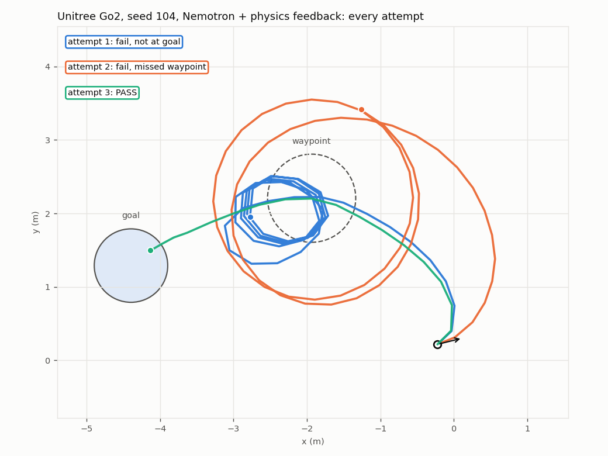

# GraspLoop

**An AI robotics engineer that writes, watches, tests and repairs its own robot code: grasping, placing and walking, on an arm, a dexterous hand, a quadruped and a humanoid.**

Give it a robot, an object and a sentence ("pick up the object from the table and hold it in the
air"). NVIDIA **Nemotron 3.5 Lightning**, served by **Nebius Token Factory**, writes a short Python
program against a 12-call grasp API. **Isaac Lab 3.0 GA** runs it on **Newton** physics without Isaac
Sim. A physics judge grades the attempt. What the simulator measured goes back to the model in
plain words ("the fingertips closed 3.0 cm above the object's centre: they closed on air"), and in
the vision condition **Nemotron 3.5 Super-VL** watches eight camera frames of the attempt and adds
what it saw. The model repairs its program, up to three attempts.

The loop does not know what the robot is. The same prompt, sandbox, judge interface, grid and films
run a Franka Panda (pick up and hold, pick and place, open a drawer), a Kuka iiwa with an Allegro
hand, and a Unitree Go2 quadruped and a Unitree G1 humanoid that walk on NVIDIA RSL-RL policies
trained on Newton in minutes (waypoint, then goal): 12 robot × task cells, 96 matched scenarios,
every one filmed and judged, in the table under "Robots × tasks" below.

The benchmark asks three questions on matched scenarios:

1. Does measured feedback turn failed programs into working ones, or is a second attempt just luck?
   (condition C versus C0, the same program rerun without repair)
2. Does a vision reviewer add anything on top of physics feedback? (D versus C, the primary comparison)
3. Can the camera judge be trusted? It never sees the physics label; its agreement, false positives
   and false negatives are measured on every filmed attempt.

Built for the Nebius × NVIDIA Global AI Hackathon, Physical AI track. Simulation only. Everything
below ran on one laptop GPU, except the replication cell, which ran on a Nebius AI Cloud H100; the Token
Factory bill for every record in `results/` is about $2.83 (2,421 calls).

Where to look first: the results below and their records in `results/`; `FEEDBACK.md` for the tool-friction log
the hackathon asks for; `docs/` for the experiments in full, numbered in reading order (index in `docs/README.md`).

## Results

**Final benchmark** (2026-10-27/28, `docs/02-benchmark-results.md`): Franka, 6 shapes ×
8 matched seeds = 48 scenarios, Nemotron 3.5 Lightning with thinking on, up to 3 attempts, 437
filmed attempts reviewed. Whole run: $1.37 of Token Factory credit, 5.7 h on one laptop GPU.

| Condition | Success by attempt 3 | 95 % CI | First attempt | $ / success |
|---|---|---|---|---|
| A scripted reference | 43/48 (90 %) | 0.78–0.95 | 43/48 | 0 |
| B Nemotron one-shot | 14/48 (29 %) | 0.18–0.43 | 14/48 | 0.005 |
| C0 rerun of B, no repair | 14/48 (29 %) | 0.18–0.43 | 14/48 | 0 |
| C physics feedback | 23/48 (48 %) | 0.34–0.62 | 12/48 | 0.014 |
| D physics + vision | 26/48 (54 %) | 0.40–0.67 | 8/48 | 0.014 |

Paired over the same scenarios: physics feedback beats one-shot and beats the no-repair rerun by
+0.19 (95 % bootstrap interval +0.04 to +0.33), so the repairs are real. Vision on top of physics
adds +0.06 (−0.10 to +0.23), not separated from zero. The camera reviewer agreed with the physics
judge on 423 of 437 attempts with no false negatives; all 14 false positives were lifts of 1–9.8 cm
under the 10 cm threshold, which a 320 × 240 frame cannot measure. Where feedback fails is as
informative as where it works: on the small sphere the reference lifts 8/8 and Nemotron 1–2/8,
because every program closes at the ball's equator and the feedback states the offset but not the
rule. On the Allegro hand the reference lifts the cube 7/8 and Nemotron 0/8.

**Same 48 scenarios with Nemotron's thinking off** (doc 02 §6): one-shot 6/48, physics 12/48,
physics + vision 17/48, for $0.54 and one hour instead of $1.16 and five. Reasoning roughly doubles
success in every condition; without it the camera reviewer's diagnosis matters more.

**Web hints from Tavily, condition E** (2026-10-29, `results/tavily-2026-10-29/`): on the small sphere,
the one shape where every Nemotron program fails the same way, each failed attempt also triggered one
Tavily search on the judge's measured sentence and the answer joined the feedback (`agent/hints.py`).
Eight matched seeds, physics alone against physics + hints: 0/8 against 0/8, paired difference +0.00.
The hints changed what the model wrote (the final failures went from eight slips to a spread of slips,
invalid programs, an unreached IK target and a miss) but not whether it succeeded, because the answers
were generic Franka handbook text: the web has no page about this scene. Six real calls, ten served
from the per-process cache of identical queries, 4 s each, +28 s per scenario.

**The cube cell on a Nebius AI Cloud H100** (2026-10-29, `docs/04`, `results/cloud-2026-10-29/`): the same code
and lockfile on an H100 VM in eu-north1. Seeds 100–107 replicated the laptop within the benchmark's own noise
(scripted 8/8 on both, physics 7/8 against 8/8), then eight new seeds made a 16-scenario cell on one machine:
one-shot 8/16, physics feedback 14/16, physics + vision 12/16. Physics beats one-shot and the no-repair rerun by
+0.38 (+0.06 to +0.69); vision adds nothing on top (−0.13, −0.44 to +0.19). The reviewer agreed with the physics
judge on 125 of 125 filmed attempts. The H100 has no RT cores and Isaac Sim cannot run on it; the kit-less stack,
the Warp cameras and the OVRTX hero camera all did. A single-environment sim is latency-bound, so the H100 was
1.2–3.5× slower per scenario than the laptop: more scenarios come from more small replicas, not a bigger GPU. 1 h 41 min
of H100 time, about $7.60, and $0.28 of Token Factory credit.

The engineering pilot (cube, 5 seeds) that preceded it is in `docs/05` §4a; its films exposed two
feedback blind spots that were fixed before the final run (doc 05 §5).

## Robots × tasks

The loop does not care what the robot is. A robot plugs in with an API object, its documentation, a
judge and the wording of its feedback (`agent/loop.py` hooks); the sandbox, the grid, the statistics,
the recorder, the clips and the demo cut are shared. Built on NVIDIA's kit-less Newton scenes only
(`docs/03-robots-x-tasks.md`):

| robot | task | controller under the program | reference | one-shot | rerun | physics feedback |
|---|---|---|---|---|---|---|
| Franka Panda | pick up and hold, 6 objects (doc 02) | IK action + binary gripper | 43/48 | 14/48 | 14/48 | 23/48 (26/48 with vision) |
| Franka Panda | **pick and place** on a target disc, cube | same | 8/8 | 4/8 | 4/8 | 7/8 |
| Franka Panda | pick and place, thin box | same | 8/8 | 3/8 | 3/8 | 5/8 |
| Franka Panda | pick and place, tall box | same | 8/8 | 0/8 | 0/8 | 1/8 |
| Franka Panda | **open a drawer** (NVIDIA cabinet scene) | same | 1/5, built, not benchmarked | | | |
| Kuka iiwa + Allegro | pick up and hold, cube | IK on link 7 + finger postures | 7/8 | 0/8 | 0/8 | 0/8 |
| **Unitree Go2** quadruped | **navigate**: waypoint, then goal | NVIDIA RSL-RL policy trained on Newton in 8 min | 8/8 | 4/8 | 4/8 | 6/8 |
| **Unitree G1** humanoid | **navigate**: waypoint, then goal | NVIDIA RSL-RL policy trained on Newton in 36 min | 8/8 | 2/8 | 2/8 | 6/8 |

Eight matched seeds per cell, three attempts, Lightning with thinking; the walkers' and place cells
were run overnight 2026-10-29 (`docs/03-robots-x-tasks.md` §3, records in
`results/scale-2026-10-29/`). Pooled over those 40 scenarios: one-shot 13/40, rerun 13/40, physics
feedback 25/40, paired +0.30 with a 95 % bootstrap interval [+0.12, +0.47], the same effect the
Franka lift benchmark measured (+0.19 [+0.04, +0.33]). On every cell physics feedback beats
one-shot and the no-repair rerun never does. The camera reviewer, given a task text per family and
one sentence about the camera, agreed with the physics judge on 231 of 264 filmed
attempts across the five cells, with 9 false positives; the false negatives are the
humanoid's body hiding the disc it stands on and a 1.5 cm finger gap the side camera cannot see
(doc 03 §3). With Nemotron's thinking off the walkers collapse: Go2 2/8 with feedback, G1 0/8, most
programs walking out of the arena. The walkers' physics condition was run twice: the first run (Go2 5/8, G1 7/8) showed
Nemotron only the first 15 s of each 60 s run; the feedback was fixed to show the start and the end
and to name the overshoot, and the rerun (Go2 6/8, G1 6/8) is the number here. First attempts vary
between runs because sampling is not deterministic; what the wording moved is the repair rate after
a failed first attempt, 3 of 7 → 7 of 11 across both walkers (doc 03 §3). The full table with costs is
`eval/matrix.py`'s output, `results/scale-2026-10-29/matrix.md`; `eval/nav_paths.py` draws a
walker's attempts top-down from the saved trace:



Attempt 1 circles the waypoint, attempt 2 loops wide, attempt 3 walks through it and stops on the
goal; between them Nemotron read "the heading error changed sign 11 times over 60 walk calls: the
turn commands overshoot the bearing instead of settling on it". Walking robots: `--robot go2|g1`; tasks:
`--task lift|place|drawer`.

## What is NVIDIA's, what is Nebius's, what is ours

| Part | Source |
|---|---|
| Scenes, robots, contact sensors, IK action, Newton/MJWarp presets | NVIDIA Isaac Lab 3.0.0 GA: `Isaac-Lift-Franka`, `Isaac-Lift-KukaAllegro`, `Isaac-Open-Drawer-Franka`, `Isaac-Velocity-Flat-UnitreeGo2`, `Isaac-Velocity-Flat-G1`, as shipped except the control settings scripted IK needs (robot gravity off and a stiff gripper drive, as NVIDIA's own Franka IK preset does; Kuka-Allegro gains ×8), marked in `agent/env.py` and `agent/allegro.py` |
| Walking controllers | NVIDIA RSL-RL PPO policies trained with NVIDIA's `train.py` on this laptop, no Isaac Sim |
| Cameras | NVIDIA Newton Warp ray tracer for the reviewer and the review clips (no OpenGL, runs in compute-only containers); NVIDIA OVRTX path tracer for the demo's hero camera |
| Code-writing model | `nvidia/Nemotron-3_5-Lightning` on Nebius Token Factory (OpenAI-compatible API) |
| Vision reviewer | `nvidia/Nemotron-3.5-Super-VL` on Nebius Token Factory |
| Web hints (condition E) | Tavily search API (Nebius), `POST /search` with `include_answer`, through `agent/hints.py` |
| Cloud compute | Nebius AI Cloud, one H100 VM in eu-north1 (`gpu-h100-sxm`, image `ubuntu24.04-cuda13.0`), driven by `eval/cloud/nebius_vm.sh`; the cube cell replicated and extended there (`docs/04`) |
| Grasp API, sandbox, physics judge, feedback, repair loop, reviewer prompt, grid, stats, videos | this repo, `agent/`, `judges/`, `eval/` (~4,300 lines) |

## Run it

Needs Isaac Lab 3.0.0 GA installed kit-less (`uv sync` in the Isaac Lab checkout, no Isaac Sim), an
NVIDIA GPU, and `NEBIUS_API_KEY` in the environment for the model conditions. No Python packages beyond
Isaac Lab GA's own (Pillow, NumPy, SciPy, Matplotlib, Requests); `ffmpeg` (on `PATH` or at `~/.local/bin/ffmpeg`)
is only for the videos. The statistics, report and matrix scripts are stdlib only and need no GPU; Python 3.12 or
newer rebuilds the committed tables byte for byte (3.12 changed float `sum()`, so older versions differ in a last digit).

```bash
PY=~/workspace/isaaclab-3.0.0-ga/.venv/bin/python      # the Isaac Lab GA interpreter

# 1. No model: the hand-written reference program, 5 seeded starts (~15 s)
$PY eval/gate_t1.py --viz none --shape cube --seeds 5 --json _logs/t1.json

# 2. Nemotron writes the program, physics feedback repairs it (~1 min per seed, ~$0.005)
$PY eval/run_loop.py --viz none --shape cube --seeds 3 --feedback physics --json _logs/loop.json

# 3. The experiment grid for one shape, all five conditions, every attempt filmed and reviewed
$PY eval/run_grid.py --viz none --shape cube --seeds 8 --seed0 100 \
    --conditions scripted,oneshot,rerun,physics,vision --review-all \
    --cameras _logs/grid/frames --video _logs/grid/video --json _logs/grid/cube.json

# 3b. Condition E: a Tavily web search on each failure mode joins the feedback (key from TAVILY_API_KEY or ~/.tavily/config.json)
$PY eval/run_grid.py --viz none --shape sphere_s --seeds 8 --seed0 100 --conditions physics,hints --json _logs/tavily/sphere_s.json

# 3c. The same cell on a Nebius AI Cloud H100 (needs the nebius CLI logged in, an AI Cloud project, ~/.ssh/id_ed25519.pub)
eval/cloud/nebius_vm.sh create gpu-h100-sxm 1gpu-16vcpu-200gb && eval/cloud/nebius_vm.sh bootstrap && eval/cloud/nebius_vm.sh push
eval/cloud/nebius_vm.sh run cube --shape cube --seeds 8 --seed0 100 --conditions scripted,oneshot,rerun,physics,vision --review-all \
    --cameras _logs/cloud/frames --video _logs/cloud/video
eval/cloud/nebius_vm.sh status cube; eval/cloud/nebius_vm.sh pull; eval/cloud/nebius_vm.sh delete   # delete stops the billing

# 4. Tables, per-trial viewer, videos
python3 eval/stats.py _logs/grid/*.json --out _logs/stats          # Wilson CIs, paired bootstrap, recovery, reviewer agreement
python3 eval/report.py _logs/grid/*.json --out _logs/report        # index.html with frames, code, verdicts, reviews
$PY eval/make_videos.py --video-dir _logs/grid/video --results _logs/grid/*.json --out _logs/review

# Every stage filmed in one go (what the demo reel was cut from)
eval/record_showcase.sh

# 5. Robots x tasks: the walkers and the place cells, one grid per cell, then the matrix and the statistics
eval/run_scale.sh                                                   # cells: go2:nav g1:nav franka:place:{cube,box_flat,box_tall}
$PY eval/nav_paths.py _logs/scale/go2_nav.json --seed 104 --condition physics --out _logs/scale/figures/go2_s104.png
$PY eval/review_record.py _logs/scale/g1_nav.json --out _logs/scale/review_g1_nav.json      # camera reviewer vs physics judge
$PY eval/refilm.py --record _logs/scale/go2_nav.json --condition physics --seed 104 --viz none --video _logs/scale/video --json _logs/refilm.json

# 6. Demo footage: replay a recorded attempt on a 1280x720 hero camera rendered by NVIDIA's OVRTX path tracer (plus the
#    side camera for a picture-in-picture), then cut the video from it. Any runner takes --hero DIR.
$PY eval/refilm.py --record _logs/scale/franka_place_cube.json --condition physics --seed 100 --attempt 3 --viz none --hero _logs/hero/video --json _logs/hero/refilm_place_cube.json
$PY eval/make_demo.py --bench _logs/bench --scale _logs/scale --hero _logs/hero/video --out _logs/demo/grasploop_draft.mp4
```

Shapes: `cube`, `box_flat`, `box_tall`, `sphere_s`, `sphere_m`, `capsule_s` and more in
`agent/env.py`. `--robot allegro` switches to the Kuka iiwa + Allegro hand, `--robot go2|g1` to the walking
robots (train their policies first with `eval/train_walkers.sh`, NVIDIA's `train.py` twice), `--task place|drawer`
to the other manipulation tasks. `--reasoning none` turns
Nemotron's thinking off; `--model ultra` or `gpt_oss` swaps the model.

## How it works

```
agent/env.py        NVIDIA's lift scene as a ManagerBasedEnv; seeded object placement; move_to / lift / gripper
agent/graspapi.py   the 12 functions a program may call, every call traced; the API text the model reads
agent/sandbox.py    AST allow-list + timeouts: generated code can only call the API
judges/physics.py   runs the hold, returns success or one of 11 failure reasons
agent/loop.py       prompt -> program -> run -> judge -> feedback in words -> repair, up to 3 attempts
agent/cameras.py    two Warp cameras; judges/vision.py films attempts and asks Super-VL for structured JSON
agent/nemotron.py   Token Factory client with cost accounting, retries and a truncation guard
eval/               gate, loop runner, grid, stats, report, videos, benchmark driver
```

Design choices that mattered, with the evidence, are in `docs/05-build-log.md`
(nine traps on day one, six fixes from the films).

## Limitations

- One model family (Nemotron 3.5) and cells of 8 to 48 matched scenarios: the intervals are wide and every
  table shows them. The 48-scenario Franka benchmark and the 40-scenario robots × tasks grid ran on one laptop;
  only the cube cell has been replicated on a second machine (the Nebius H100, `docs/04`).
- The reviewer is Nemotron 3.5 Super-VL because Token Factory served no Cosmos 3 model during the
  hackathon (`FEEDBACK.md`, 2026-10-27).
- The Allegro port reaches its targets and its scripted grasp lifts the cube 7/8, but Nemotron
  never does (0/8): it is a demonstration that the API generalises and that the model's priors do not.
  Part of that 0/8 is a feedback gap: the feedback says where the hand closed only after
  `close_gripper()`, not after the Allegro's own `grasp()`, which 19 of the 32 repair messages followed
  (`docs/02` §2, §4).
- Newton/MJWarp is not run-to-run deterministic in its default mode; the rerun condition C0 measures
  that noise floor instead of pretending it is zero.
- Condition E (Tavily web hints) was measured on one shape and eight seeds, the hardest cell, and found
  nothing: a null on 8 scenarios bounds the effect loosely (the interval on each arm reaches 0.32). Its
  queries named the object's shape but not its size (`docs/04` §6).


## Licence

Apache-2.0 (see `LICENSE`). NVIDIA Isaac Lab assets are downloaded at run time and not committed.
